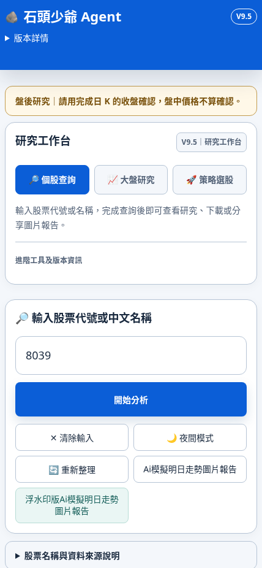
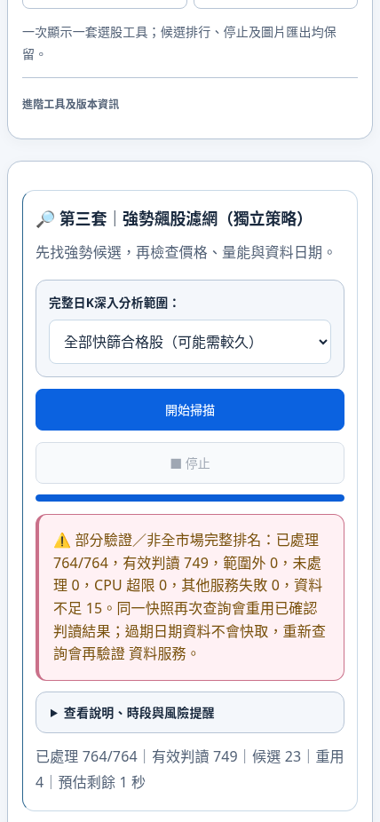
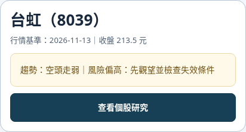

# V9.5 介面與操作流程整理

基準 main：`756cdedfb219dbfba9d02842046bcd48f5da2cdf`。分支：`fix/v95-interface-simplification`。本次只建立 PR；不合併、不發布 Pages 或 Worker。

## 變更與流程

修改前：兩排重複導覽 → 策略掃描 → 個股查詢；摘要上同時出現圖片／複製與兩顆報告按鈕。六顆錨點只換 hash，無法切換隱藏的策略面板；寶塔線／2560 的既有個股查詢也可能留在策略頁。

修改後：研究工作臺選策略 → 開始掃描 → 入選結果 → 查看個股研究 → 查看生命線圖片／下載。完整技術資料由研究視窗中的「查看完整技術依據」開啟，「返回結果」關閉視窗。卡片只留股名代號、行情日期收盤、一句趨勢與風險及一顆主要按鈕。

- 刪除失效的六顆重複錨點；移除可用但與工作臺重複的八個頂端捷徑。
- 保留研究工作臺的分頁、六策略選擇、進階工具、預設個股分頁與處理函式。僅將原 43px 選擇鈕補至最低 44px 觸控高度。
- 兩顆報告入口合併：研究完成開既有研究內容；研究尚未備妥仍可開既有技術資料，顯示資料限制。
- 圖片／複製原面板與處理器完整保留，移至個股研究內。生命線僅改入口名稱與位置。
- 用現有分頁 API 修復寶塔線、2560 的個股入口；未包裝或替換全域查詢、掃描函式。
- 沿用原掃描器的停止與防重複機制，統一「開始掃描／處理中…」，進度與錯誤保持可見。強勢飆股原本折在說明裡的進度移至外層。
- 換股時關閉前一研究視窗、清除前一圖片處理中／錯誤狀態；原圖片快照清除機制保留。
- 資料來源收成頁尾一處展開；風險、行情日期及資料不足不刪除。首頁移除冗長副標，保留白話收盤提醒。

## 版本與保護

介面 DISPLAY／RELEASE／fileVersion 為 V9.5，cacheVersion 為 `V9.5-UI1`。更新改動資源及獨立大盤入口快取；未全域替換 V9.4。生命線引擎仍為 `KLINE_LIFE_03_V1`，生命線研究／多頁 PNG 保留原 V9.3.2／V9.4 可追溯標記。

原 inline 分析程式、六套掃描器、2560 規則、排序、Top8、指標／評分／風險閘門、Kronos、Worker 與資料契約不變。所有 `kline-life-03-*`、`research-life-source-audit-v932.js`、`data/`、`evidence/`、`config/` 均無修改。新增精確 SHA256 保護與原研究工作臺程式片段比對；舊測試只更新前端版本期待、合法新增入口模組及新的圖片入口動線，不移除斷言。

## 盤點與未動項目

完整控制項表：[188 個控制項與 selector、事件及處理](V9.5_CLICKABLE_INVENTORY.md)。兩顆原報告按鈕與八個頂端捷徑均有實際點擊記錄；六顆失效錨點逐顆證實停在原策略。

原始生成器／複製／波浪／未來 K 棒等其餘入口，未逐一測試者列為「待確認」並保留，不因名稱相近刪除。第⑥套個股圖片按鈕仍直接開其原圖片，沒有改成其他功能。

執行前與結束前檢查的其他開啟 PR：#54、#46、#42、#41、#35、#34。未合併或覆蓋其功能。

## 驗證

| 檢查 | 修改前 | 修改後 |
| --- | --- | --- |
| npm ci | 成功 | 成功 |
| npm test | 993 通過，0 失敗／跳過 | 996 通過，0 失敗／跳過 |
| npm run test:contract | 50 通過 | 50 通過 |
| npm run research:validate | 通過 | 通過 |
| UI 實點與畫面斷言 | 已盤點失效／重複入口 | 18 組通過 |

UI 檢查涵蓋六策略切換與真實按鈕事件、處理中與防重複、異常回復、研究與完整依據、生命線原解析度 PNG 下載、圖片失敗仍保留風險、換股不殘留，以及 428×926、390、360、1440 寬度的溢出與工具列遮擋。零檔／資料不足使用明確標為介面測試的狀態物件，不當作真實選股證據。正式行情一致性另用完整封存快照重播。

第一輪 CI 的四個舊瀏覽器工作因舊入口假設失敗：兩個仍斷言已刪除的六顆錨點，另兩個直接點首頁圖片面板。已將測試改為實點工作臺六策略及「查看個股研究」後操作原圖片；原有數值、尺寸、下載、分享、快照與時效斷言全部保留。重新執行的既有研究 29 項、波浪／專業匯出 32 項及 Kronos 凍結基準 6 個個股／指數案例通過；沒有修改 Kronos 或圖片產生器。

V9.4 原測試驗證桌面與 iPhone 12 Pro Max Chromium：1284×2778、單頁 PNG、單檔分享、使用者手勢、分享取消／失敗、下載替代、ZIP、換股清除。V9.2 舊生命線 API、V9.3.2／V9.4 報告、研究圖表與獨立大盤入口另有回歸。

正式快照：2026-11-13，1,965 筆，市場檔 SHA256 `e8208cb5617cac682fc4908ca0cc850531f49c5f97f27b944162fb84c1907a40`。相同同日官方日線／封存回應，原算法原按鈕重播；資料不足與未驗證狀態照實保留，沒有補造行情。

六策略完整有序投影逐欄位完全相等（代號、資格、狀態、分數、價格、各組榜單含第⑥套 A/B 的 ranked/formal/top8）。[一致性摘要、候選順序與 SHA256](V9.5_SELECTION_COMPARISON.json)。

| 策略 | 本次原規則實際分析 | 原 candidates 數量／榜單 |
| --- | --- | --- |
| 主動式主升 | 300 | 0；292 筆資料不足，不能宣稱全市場零檔 |
| 明日當沖 | 70 | 17；正式／候補資格仍按原門檻 |
| 強勢飆股 | 764 | 23；15 筆資料不足 |
| 寶塔線點金術 | 764 | 120；15 筆資料不足 |
| 2560戰法 | 1,921 | 15；78 筆資料不足、172 筆資料異常 |
| 結構轉強・反轉確認 | 728 | A/B 全部排序分組相等；5 筆 issue |

1,965 筆全市場逐策略依原排除／初篩選取母體，分析數量不同是原規則所致。資料不足與異常均前後一致，沒有視為合格、補行情或放寬條件。這是完整回歸一致性證據，不代表所有市場資料均完整認證。早期中斷／超時重播未當作通過；最終保留同快照前四套與接續第五、六套兩段完整結果，合併後嚴格比較。

重現：在基準工作樹與本分支分別執行 `scripts/tests/v95-scan-browser.cjs`（基準以 `V95_SOURCE_ROOT` 指向工作樹），再以 `node scripts/compare-v95-selection.cjs BEFORE.json AFTER.json` 比對。`V95_STRATEGIES` 可接續指定策略，不改掃描範圍或選股規則。

## 手機截圖

首頁、策略結果、精簡個股卡片為實際 Chromium 截圖。

## 限制

- 僅 Chromium 模擬；未完成 iPhone 真機及 LINE App 實測。Web Share 由瀏覽器介面模擬成功／取消／失敗，另驗證 PNG 原檔下載替代。
- 封存行情回歸不代表即時 Worker 或正式部署驗收；本次不發布。
- 研究用途、未經驗證的績效與原資料缺口仍保留；未宣稱選股效果改善。
